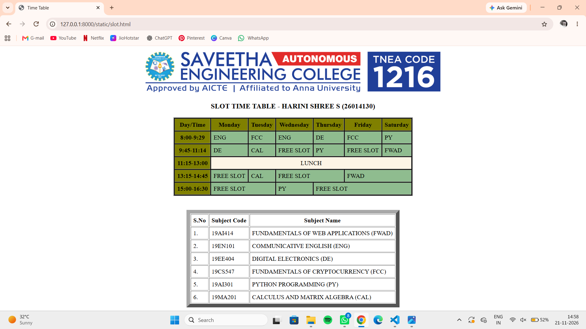

# Ex04 Time Table
## Date:21/11/2026

## AIM
To write a html webpage page to display your slot timetable.

## ALGORITHM
### STEP 1
Create a Django-admin Interface.

### STEP 2
Create an App inside the Django project.

### STEP 2
Create a static folder uder the created App and insert HTML code.

### STEP 3
Create a simple table using ```<table>``` tag in html with the relevant attributes.

### STEP 4
Add rows using ```<tr>``` tag.

### STEP 5
Add your course schedule using ```<td>``` tag.

### STEP 6
Execute the program using runserver command.

## PROGRAM
```
<html>
    <head>
        <title>Time Table</title>
    </head>
    <body>
        <center>
        
        <table bgcolor = "mint" border="2" cellpadding="6" cellspacing="2">
        <h3>SLOT TIME TABLE - HARINI SHREE S (26014130)</h3>
        <tr bgcolor="olive">
            <th>Day/Time</th>
            <th>Monday</th>
            <th>Tuesday</th>
            <th>Wednesday</th>
            <th>Thursday</th>
            <th>Friday</th>
            <th>Saturday</th>
        </tr>

        <tr bgcolor="DarkSeaGreen">
            <th bgcolor="olive">8:00-9:29</th>
            <td>ENG</td>
            <td>FCC</td>
            <td>ENG</td>
            <td>DE</td>
            <td>FCC</td>
            <td>PY</td>
        </tr>

       <tr bgcolor="DarkSeaGreen">
            <th bgcolor="olive">9:45-11:14</th>
            <td>DE</td>
            <td>CAL</td>
            <td>FREE SLOT</td>
            <td>PY</td>
            <td>FREE SLOT</td>
            <td>FWAD</td>
        </tr>

        <tr bgcolor="DarkSeaGreen">
            <th bgcolor="olive">11:15-13:00</th>
            <td colspan = "6" align = "center" bgcolor ="oldlace">LUNCH</td>
        </tr>

        <tr bgcolor="DarkSeaGreen">
            <th bgcolor="olive">13:15-14:45</th>
            <td>FREE SLOT</td>
            <td>CAL</td>
            <td colspan="2">FREE SLOT</td>
            <td colspan="2">FWAD</td>
        </tr>

        <tr bgcolor="DarkSeaGreen">
            <th bgcolor="olive">15:00-16:30</th>
            <td colspan ="2">FREE SLOT</td>
            <td>PY</td>
            <td colspan = "3">FREE SLOT</td>
        </tr>
    </table>

    <br><br>


    <table border="10" cellpadding="6" cellspacing="2">

        <tr>
            <th>S.No</th>
            <th>Subject Code</th>
            <th>Subject Name</th>
        </tr>

        <tr>
            <td>1.</td>
            <td>19AI414</td>
            <td>FUNDAMENTALS OF WEB APPLICATIONS (FWAD)</td>
        </tr>

        <tr>
            <td>2.</td>
            <td>19EN101</td>
            <td>COMMUNICATIVE ENGLISH (ENG)</td>
        </tr>

        <tr>
            <td>3.</td>
            <td>19EE404</td>
            <td>DIGITAL ELECTRONICS (DE)</td>
        </tr>

        <tr>
            <td>4.</td>
            <td>19CS547</td>
            <td>FUNDAMENTALS OF CRYPTOCURRENCY (FCC)</td>
        </tr>

        <tr>
            <td>5.</td>
            <td>19AI301</td>
            <td>PYTHON PROGRAMMING (PY)</td>
        </tr>

        <tr>
            <td>6.</td>
            <td>19MA201</td>
            <td>CALCULUS AND MATRIX ALGEBRA (CAL)</td> 
        </tr>
    </table>

        </center>

    </body>
</html>

```

## OUTPUT


## RESULT
The program for creating slot timetable using basic HTML tags is executed successfully.
